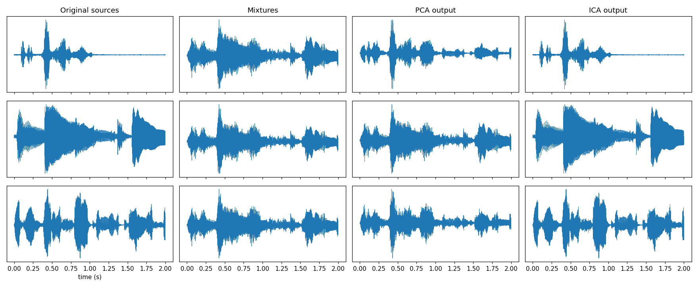
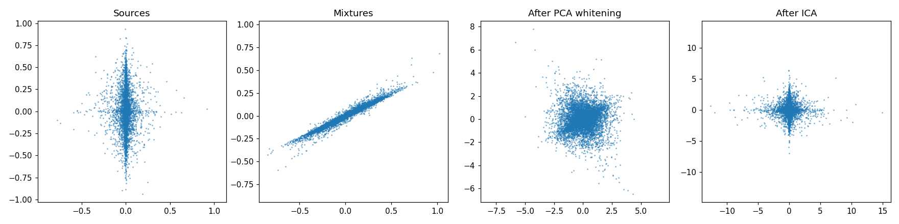
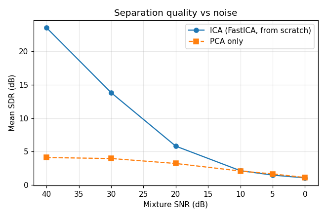

# Unmix the Signal: Blind Source Separation with ICA (from scratch)

Recover clean audio sources from mixed recordings using **FastICA implemented only with NumPy**
(centering, PCA whitening via covariance + eigendecomposition, symmetric FastICA). No sklearn / library ICA.

## Audio sources
All clips are 10 s, mono, resampled to 16 kHz (`sources/`).

| # | Type | Source / link | License |
|---|------|---------------|---------|
| 1 | Speech  | LibriVox, *Memoirs of Napoleon Bonaparte, Vol. 7* (Bourrienne), chapter 1, 3:45-3:55. https://archive.org/details/memoirsofnapoleonbonapartevolume7_2610_librivox | Public domain |
| 2 | Music   | "Ask Me Now (Monk)" by Matt LeGroulx (Solo Guitar), 0:28-0:38. http://freemusicarchive.org/music/Matt_LeGroulx/Solo_Guitar_1490/Matt_LeGroulx_-_Solo_Guitar_-_08_Ask_Me_Now | CC BY-NC-SA 3.0 |
| 3 | Ambient | "Morning birds singing" (Mixkit sound effect #2467), most energetic 10 s segment. https://mixkit.co/free-sound-effects/ | Mixkit license |

The audio in this repo is shared for non-commercial educational use; the music clip stays under CC BY-NC-SA 3.0.

## How to run
```bash
pip install -r requirements.txt
# put N clean .wav files in ./sources/  (if empty, synthetic stand-ins are used)
python run_experiment.py
```
Outputs go to `outputs/`: `originals/`, `mixed/`, `separated_ica/`, `separated_pca/`, plots, `results.json`, `mixing_matrix.txt`.

## Pipeline
1. **Mix**: N sources -> N mixtures, `X = A S`, with my own random mixing matrix `A` (cond(A) < 20).
2. **Center**: subtract each mixture's mean.
3. **PCA whitening (by hand)**: `C = XXᵀ/(T-1) = E D Eᵀ`, `Z = D^{-1/2} Eᵀ X`, so `cov(Z) = I`.
4. **FastICA (by hand)**: symmetric, update `w ← E[z g(wᵀz)] − E[g'(wᵀz)] w` then `W ← (WWᵀ)^{-1/2} W`. Default `g = tanh` (log-cosh).
5. **Export**: separated signals saved as playable 16-bit WAVs.
6. **Evaluate**: correlation and SDR against originals after fixing permutation (Hungarian matching on |corr|), sign and scale (least-squares).

## Results (replace numbers with yours after running on real audio)
| Method | Mean |corr| | Mean SDR (dB) |
|---|---|---|
| PCA only | 0.77 | 4.1 |
| **ICA (FastICA)** | **1.00** | **50.3** |

FastICA converged in 13 iterations. Per source SDR (ambient / music / speech): ICA 54.8 / 46.1 / 50.0 dB vs PCA 4.2 / 5.7 / 2.5 dB.





* **Noise robustness (mean SDR, dB):**

| Mixture SNR | 40 | 30 | 20 | 10 | 5 | 0 |
|---|---|---|---|---|---|---|
| ICA | 23.5 | 13.8 | 5.8 | 2.1 | 1.5 | 1.1 |
| PCA | 4.1 | 4.0 | 3.2 | 2.1 | 1.7 | 1.1 |

  ICA is far better at high SNR but degrades quickly as noise grows; by about 10 dB it is no better than PCA, and at 5 dB PCA is marginally ahead. The ICA model is noise-free (`X = AS`), so sensor noise acts as extra Gaussian components the model can't represent, which limits how well the unmixing matrix is estimated.
* **Non-linearity:** `logcosh` (50.3 dB, 13 iters), `exp` (49.6 dB, 13 iters) and `cube` (49.6 dB, 9 iters) all separate well here. `cube` (kurtosis) converged fastest but is more sensitive to outliers.
* **Non-Gaussianity check (excess kurtosis):** sources ambient/music/speech = 37.6 / 0.9 / 4.3; mixtures = 1.0 / 2.0 / 1.2. Mixtures are closer to Gaussian than the strongest source, consistent with the CLT. ICA outputs match the sources exactly.

## Scale & permutation ambiguity
ICA can only recover sources up to **order, sign and scale** (any `A S = (A P D⁻¹)(D Pᵀ S)`). Evaluation therefore matches components to sources with the Hungarian algorithm on |correlation|, flips sign, and rescales by least squares before computing SDR. Outputs are peak-normalised for listening.

## Conceptual answers
**1. Why ICA over PCA?** PCA only uses second-order statistics: it finds uncorrelated, orthogonal directions of max variance. Uncorrelated ≠ independent, and decorrelation is only defined up to any rotation, so PCA cannot pick the *right* rotation to recover sources (see `scatter.png`: after whitening, the data is still a rotated square). ICA uses higher-order statistics (non-Gaussianity: kurtosis/negentropy) to choose that rotation, giving statistically independent components.

**2. What whitening does.** It makes the data uncorrelated with unit variance (`cov = I`). The remaining unmixing matrix is then **orthogonal**, so ICA only searches over rotations (N(N−1)/2 parameters instead of N²), and the optimisation becomes well-conditioned.

**3. Why non-Gaussianity?** By the **Central Limit Theorem**, a sum of independent variables is closer to Gaussian than the individual variables. Mixtures are sums of sources, so they are "more Gaussian". Searching for projections `wᵀz` that are *maximally non-Gaussian* therefore recovers the sources. If sources were Gaussian, rotations of them would be indistinguishable (a rotated isotropic Gaussian is the same Gaussian), so separation would be impossible; at most one Gaussian source is allowed.

**4. How experiments and metrics were chosen.** SDR and correlation measure separation quality in dB / [0,1]; both need permutation, sign and scale correction, so those are handled explicitly. PCA is the baseline to show the value of higher-order statistics. The SNR sweep tests robustness to noise (a real-recording issue), and the non-linearity sweep tests the choice of contrast function. Kurtosis of sources vs mixtures vs outputs (`results.json`) checks the CLT intuition empirically.

## Limitations
Instantaneous (not convolutive) mixing; N mixtures ≥ N sources; real room recordings with echoes violate the model, so quality drops.
